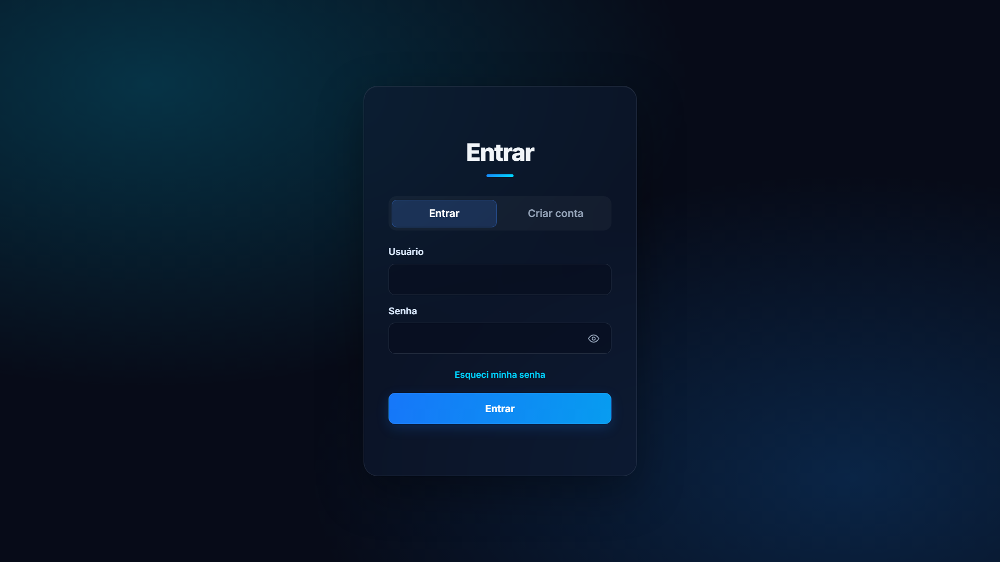
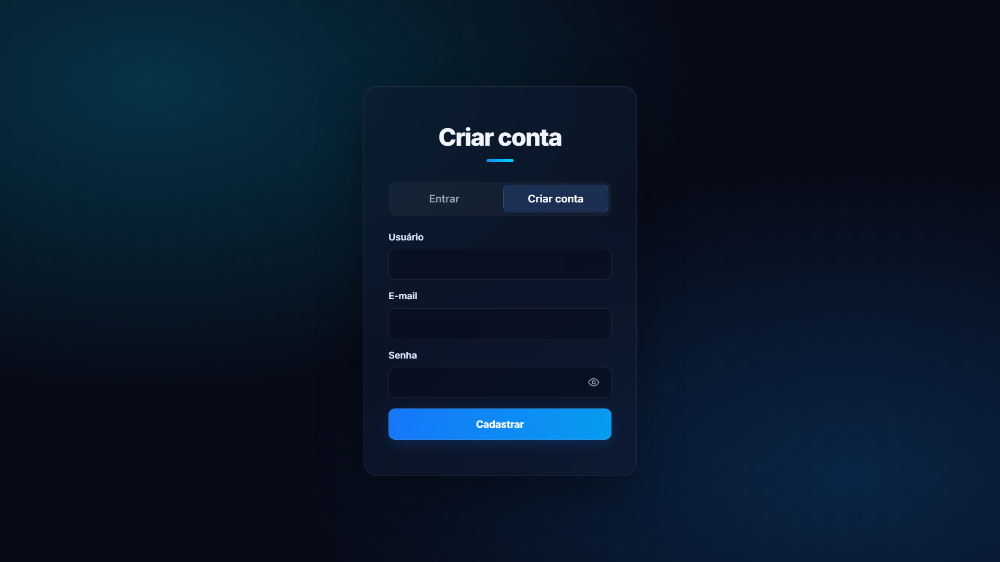

# WebNest LoginPage

Uma página de autenticação moderna, responsiva e com integração ao Supabase, desenvolvida para oferecer uma experiência simples e funcional de acesso e gerenciamento de contas.

Versão 1.0

🔗 **Acesse o projeto:** [WebNest LoginPage](https://gabriel-silira.github.io/WebNest-LoginPage/)

---

## 📸 Capturas de tela

### Tela de login



### Tela de cadastro



---

## 🚀 Funcionalidades

- **Login com nome de usuário e senha:** autenticação integrada ao Supabase.
- **Cadastro de usuários:** criação de contas com nome de usuário, e-mail e senha.
- **Recuperação de senha:** solicitação de link para redefinição por e-mail.
- **Redefinição de senha:** atualização da senha por meio do fluxo de recuperação.
- **Exibição de senha:** opção para mostrar ou ocultar a senha digitada.
- **Gerenciamento de sessão:** persistência da sessão e encerramento de sessão (_logout_).
- **Validação de formulários:** verificação dos dados inseridos e exibição de mensagens de feedback.
- **Interface responsiva:** layout adaptável a diferentes tamanhos de tela.

---

## 🛠️ Tecnologias utilizadas

| Tecnologia              | Aplicação                                       |
| ----------------------- | ----------------------------------------------- |
| HTML5                   | Estrutura das páginas e formulários             |
| CSS3                    | Estilização, layout e responsividade            |
| JavaScript              | Validações, interações e lógica de autenticação |
| Supabase Auth           | Cadastro, login e recuperação de senha          |
| Supabase Edge Functions | Autenticação por nome de usuário                |
| PostgreSQL              | Armazenamento dos perfis e dados relacionados   |
| Git e GitHub            | Versionamento e hospedagem do código            |
| GitHub Pages            | Publicação do projeto                           |

---

## 🔐 Segurança

O projeto utiliza recursos do Supabase para gerenciar a autenticação e proteger os dados dos usuários.

- Row Level Security (RLS) habilitado na tabela `profiles`.
- Política de leitura que restringe o acesso ao próprio perfil.
- Permissões da tabela revisadas e restringidas.
- Chave administrativa utilizada no servidor, por meio dos Secrets da Edge Function.
- Validação dos dados recebidos pela função de autenticação.

---

## 📂 Estrutura do projeto

```text
WebNest-LoginPage/
├── assets/
│   ├── WebNest_Logo.png
│   ├── Login.png
│   └── Cadastro.png
├── script/
│   └── script.js
├── style/
│   └── style.css
├── index.html
└── README.md
```

---

## 🎯 Objetivo do projeto

Este projeto foi desenvolvido para praticar e aplicar conhecimentos de desenvolvimento web, integração com serviços de backend, autenticação de usuários, gerenciamento de sessões e segurança de banco de dados.

Além da construção da interface, o projeto explora a integração entre tecnologias de frontend e recursos do Supabase para criar uma aplicação funcional.

---

**Desenvolvido por [Gabriel Silira](https://github.com/gabriel-silira) | WebNest**
